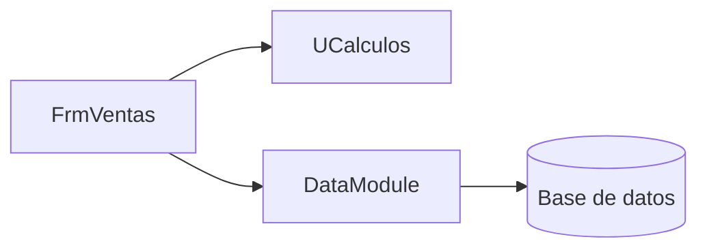

# Dependencias de Pedidos Legado

<!--
Etapa 1 · Entender (plan mode).
Dibuja quién usa a quién: unidades, formularios y la base de datos.
- Una flecha A --> B significa «A usa a B» (lo ves en la cláusula uses o en una consulta SQL).
- Incluye la base de datos (DBISAM) como un nodo: es parte del sistema.
Punto de control E1: el diagrama incluye la base de datos.

Ejemplo genérico (de otro sistema, no de este):


-->

```mermaid
flowchart LR
    %% Escribe aquí tu diagrama
```

## Preguntas guía

1. ¿Qué unidad usan casi todas las demás? ¿Qué pasaría si cambia?
2. ¿Qué unidad no depende de formularios ni de la base de datos? ¿Por qué eso importa para migrar?
