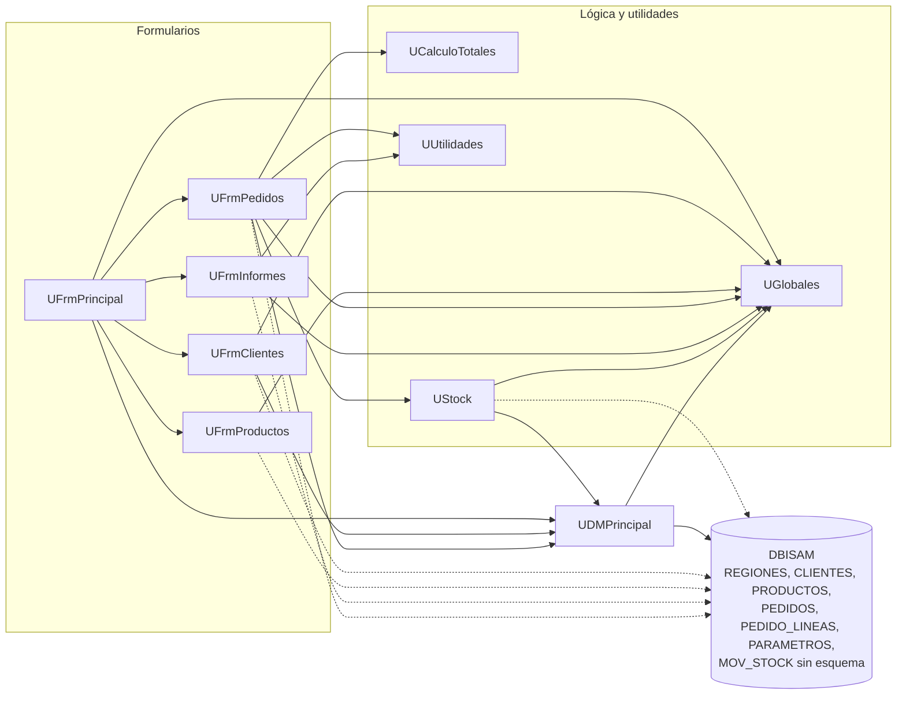

# Dependencias de Pedidos Legado

Una flecha A --> B significa «A usa a B», tomada de las cláusulas `uses` o de consultas SQL. Las flechas punteadas son accesos directos a la base que se saltan el data module.

Accesos directos (punteados): `UFrmClientes.dfm` (`tblCli` sobre CLIENTES), `UFrmProductos.dfm` (`tblProd` sobre PRODUCTOS), `UFrmInformes.pas:65-66` (PEDIDOS + CLIENTES), `UFrmPedidos.pas:276` y `UStock.pas:61` (consultas `TDBISAMQuery` propias).

## Preguntas guía

1. **¿Qué unidad usan casi todas las demás?** `UGlobales`: la usan 7 de las 9 unidades con `uses` propio (todas salvo `UCalculoTotales` y `UUtilidades`). Le sigue `UDMPrincipal` (usado por `UFrmPrincipal`, `UFrmClientes`, `UFrmPedidos` y `UStock`). Si cambia `UGlobales` (p. ej. la ruta de datos o `gTasaIVA`) se afecta a casi todo el sistema, y como es estado global mutable, el cambio es difícil de rastrear.
2. **¿Qué unidad no depende de formularios ni de la base?** `UCalculoTotales` (solo `SysUtils`), `UUtilidades` (`SysUtils`, `DateUtils`) y `UGlobales` (sin `uses`). Importa para migrar porque son la fuente de las reglas de negocio y se pueden portar a `PedidosWeb.Core` y probar sin interfaz ni base. Ojo: `UStock` depende del DM y de `Dialogs` (`ShowMessage`), por lo que no es portable tal cual.
