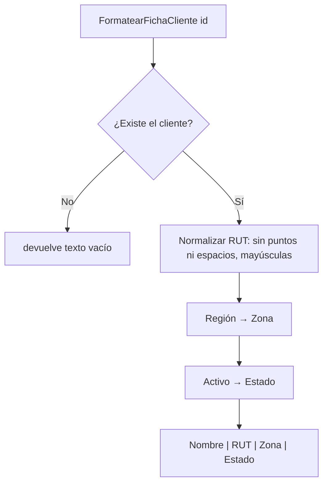

# ClientesService

Ubicación: `src/PedidosWeb.Core/Clientes/ClientesService.cs` · Namespace: `PedidosWeb.Core.Clientes`

## Propósito
Servicio **heredado** que arma la ficha de un cliente para mostrar en pantalla y responde si un cliente existe y está activo. Trabaja sobre una lista de `Cliente` en memoria. No lo usa la API: la consulta de clientes de HU-02 va por `IClienteRepositorio` / `ClienteRepositorioEnMemoria`.

## API pública

| Miembro | Devuelve | Qué hace |
|---|---|---|
| `ClientesService()` | — | Usa los 8 clientes de `ClientesDeEjemplo.Crear()`. |
| `ClientesService(List<Cliente> l)` | — | Usa la lista indicada (útil en tests). |
| `FormatearFichaCliente(string id)` | `string` | Ficha en texto: `Nombre \| RUT \| Zona \| Estado`. Devuelve `""` si el id no existe. |
| `proc3(string id)` | `bool` | `true` solo si el cliente existe y está activo. `false` si está inactivo o no existe. |

El id se compara de forma exacta (`"C-001"`, sin ignorar mayúsculas).

## Reglas de negocio
- **RUT**: se quitan puntos y espacios y se pasa a mayúsculas (`76.990.011-k` → `76990011-K`, `76 432 198-7` → `76432198-7`). No valida el dígito verificador.
- **Zona** según la región del cliente:

| Región | Zona |
|---|---|
| `RM`, `V` | Zona centro |
| `VIII` | Zona sur |
| `II` | Zona norte |
| otra | Sin zona |

- **Estado**: `Activo` o `Inactivo` según `Cliente.Activo`.

## Ejemplo de uso
```csharp
var servicio = new ClientesService();

servicio.FormatearFichaCliente("C-001"); // "Ferretería El Clavo | 76123456-0 | Zona centro | Activo"
servicio.FormatearFichaCliente("C-004"); // "Almacén La Esquina | 76990011-K | Zona centro | Activo"
servicio.FormatearFichaCliente("C-999"); // ""

servicio.proc3("C-001"); // true
servicio.proc3("C-007"); // false (inactivo)
servicio.proc3("C-999"); // false (no existe)
```

## Diagrama


## Tests
`tests/PedidosWeb.Core.Tests/Clientes/ClientesServiceTests.cs` (4 tests): cliente inexistente → `""`, ficha de C-001, RUT con puntos y «k» minúscula normalizado (C-004), y `proc3` para activo, inactivo e inexistente.

## Notas
- `proc3` conserva su nombre original, poco claro (equivale a «existe y está activo»). `proc2` ya se renombró a `FormatearFichaCliente`.
- La búsqueda recorre la lista completa en cada llamada; es suficiente para los 8 clientes de ejemplo.
- Los nombres de los tests aún empiezan con `Proc2_` / `Proc3_`.
